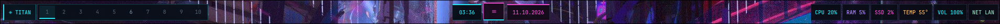
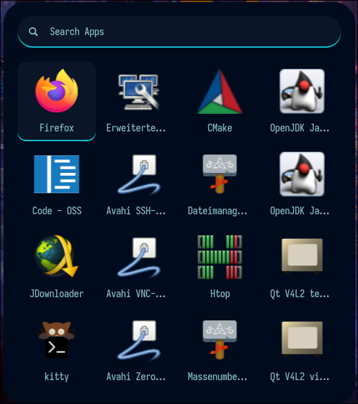
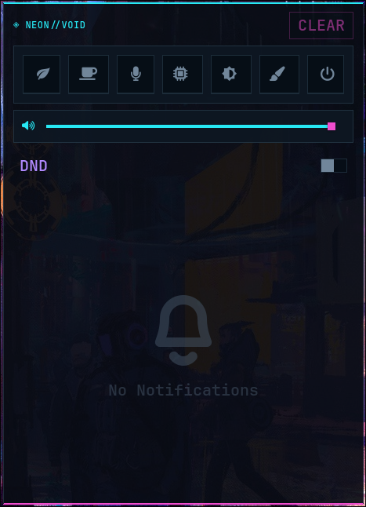
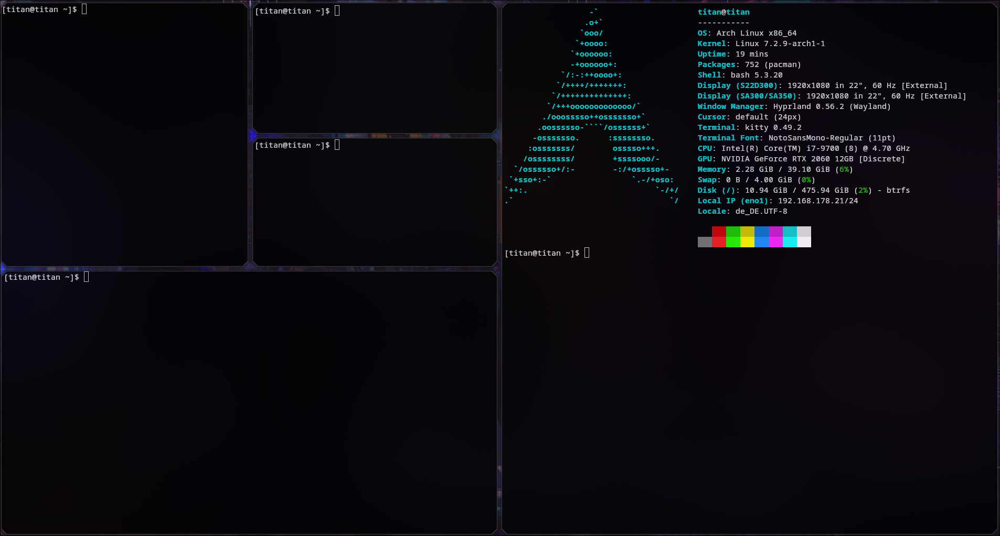

# ⚡ ARCH LINUX — NEON VOID

### An Angular Cyberpunk-Inspired Hyprland Desktop

A personal Arch Linux dotfiles project built around **Hyprland**, sharp geometric shapes, dark surfaces, and vibrant neon accents. Inspired by futuristic sci-fi HUDs and cyberpunk interfaces, NEON VOID aims to create a cohesive Wayland desktop that combines a distinctive visual identity with a practical everyday workflow.

  <strong>CYAN</strong> <code>#27e8f4</code> &nbsp; · &nbsp;
  <strong>MAGENTA</strong> <code>#f04dce</code> &nbsp; · &nbsp;
  <strong>ANGULAR HUD</strong> &nbsp; · &nbsp;
  <strong>DARK INTERFACE</strong>

---

## 🖥️ Desktop Preview

NEON VOID uses a dark, futuristic interface with angular details, neon highlights, and a consistent design language across its desktop components.

---

## ✨ Features

- **Hyprland** — Dynamic tiling Wayland compositor
- **Waybar** — Interactive desktop bar with clickable pages, scrolling controls, network access, and hover information
- **Rofi** — Application launcher matching the overall cyberpunk aesthetic
- **SwayNC** — Notification center with a power button connected to the custom Quickshell powermenu
- **Kitty** — Terminal emulator with angular, futuristic styling
- **Quickshell Powermenu** — Quick access to power actions such as sleep, reboot, and shutdown
- **Modular Lua configuration** — Hyprland settings separated into individual modules
- **Neon visual identity** — Cyan `#27e8f4`, magenta `#f04dce`, and dark surfaces

> **Project status:** Work in progress. Some components and interactions are still being refined.

---

## 🎨 Design & Components

### 01 — Waybar

The central desktop bar combines system information, controls, and quick access to frequently used functions.

- **Clickable and scrollable pages** for navigation and interaction
- **Network access** for quickly opening network configuration
- **Hover information** on other modules to keep the interface informative without unnecessary clutter
- **Neon styling** that complements the rest of the desktop

### 02 — Rofi

The application launcher provides a quick way to access applications while maintaining the desktop's angular cyberpunk look.

### 03 — SwayNC

The notification center extends the same visual language to desktop notifications.

The power button opens the custom [Quickshell Powermenu](quickshell/powermenu/shell.qml), which provides access to actions such as **sleep, hibernate,lock, logout, reboot, and shutdown**.

> **Note:** The other notification-center buttons are still a work in progress like Powerprofiles, Theme switcher.

### 04 — Kitty Terminal

Kitty provides the terminal environment for everyday command-line work, system administration, and configuration editing.

The terminal layout uses angular borders and technical visual details inspired by futuristic cyberpunk interfaces.

---

## 🧩 Technology Stack

| Component | Purpose |
|---|---|
| Arch Linux | Base operating system |
| Wayland | Display protocol |
| Hyprland | Window manager and compositor |
| Lua | Modular configuration |
| Waybar | Desktop bar and system information |
| Rofi | Application launcher |
| SwayNC | Notification center |
| Quickshell | Custom powermenu |
| Kitty | Terminal emulator |

---

## ⌨️ Keybindings & Configuration

The Hyprland configuration is split into multiple Lua modules to keep settings organized and easier to maintain.

### Hyprland Modules

| Module | Purpose |
|---|---|
| [Autostart](hypr/modules/autostart.lua) | Startup applications and services |
| [Decoration](hypr/modules/decoration.lua) | Window appearance and visual effects |
| [Environment](hypr/modules/env.lua) | Environment variables |
| [Layouts](hypr/modules/layouts.lua) | Window layout settings |
| [Miscellaneous](hypr/modules/misc.lua) | Additional Hyprland settings |
| [Monitors](hypr/modules/monitors.lua) | Monitor configuration |
| [Window Rules](hypr/modules/windowrules.lua) | Window-specific behavior |
| [Input](hypr/modules/input.lua) | Keyboard, mouse, and input settings |

The main configuration entry point is [hyprland.lua](hyprland/hyprland.lua), which brings the configuration together.

**Monitor setup:** Review `hypr/modules/monitors.lua` if your monitor arrangement requires specific settings. The configuration is being adapted to work across different hardware setups.

### Default Keybindings

| Action | Shortcut |
|---|---|
| Open terminal | `SUPER + ENTER` |
| Open application launcher | `SUPER + SPACE` |
| Close active window | `SUPER + C` |
| Switch workspace | `SUPER + 1–10` |
| Lock screen | `SUPER + M` |
| Reload Waybar and SwayNC | `SUPER + R` |

*Keybindings reflect the current configuration and may change as the project evolves.*

---

## 🚀 Installation

NEON VOID is designed for Arch Linux running Hyprland on Wayland.

The configuration is still being prepared for broader use. Before applying it to another system:

1. **Review the repository** and identify the components you want to use.
2. **Back up your existing configuration** before replacing any files.
3. **Check the required packages and dependencies**, including any scripts or external tools used by the configuration.
4. **Review the monitor configuration** and adapt it if necessary.
5. **Apply the configuration** according to the repository's directory structure.
6. **Test each component** after logging into Hyprland.

> **Important:** This repository is not yet a universal installer. Do not overwrite existing configuration files without making a backup first. Package dependencies, startup commands, and hardware-specific settings still need to be documented and verified.

---

## 🛠️ Project Status

**Status: Work in progress**

NEON VOID is an evolving personal desktop configuration focused on:

- A cohesive angular cyberpunk HUD aesthetic
- Consistent styling across Wayland components
- A modular and maintainable Hyprland configuration
- Practical interactions and everyday usability
- Improved portability across different systems

---

## 📸 Screenshot Gallery

| Component | Preview |
|---|---|
| Waybar | [View configuration](assets/Waybar.png) |
| Rofi | [View configuration](assets/Rofi.png) |
| SwayNC | [View configuration](assets/Swaync.png) |
| Kitty | [View configuration](assets/Kitty-Layout.png) |

---

  Built on Arch Linux · Powered by Hyprland · Styled with neon

